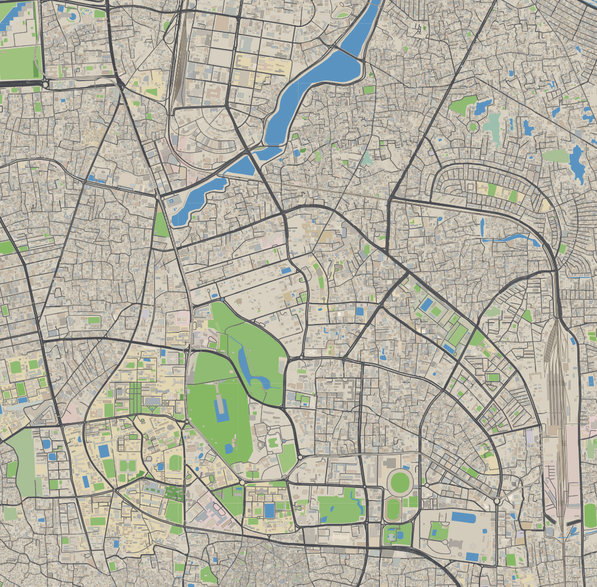

# Dhaka Bus Simulator

A browser-based 2D top-down bus driving game set on the **real map of Dhaka**, generated from
OpenStreetMap data at build time. TypeScript + Vite + PixiJS v8 (WebGL), deployable as a static site.

> Status: **Phase 1** — data pipeline (core bbox: Farmgate → Shahbag → Motijheel) and a static,
> streamed render of roads, buildings, water, landuse, flyovers and the MRT viaduct with pan/zoom.

## Quick start

```bash
npm install
npm run data:build      # downloads the Bangladesh OSM extract (~360 MB, cached) and builds chunks
npm run dev             # http://localhost:5173
```

Controls (Phase 1 map viewer): drag or WASD/arrows to pan, mouse wheel or `+`/`-` to zoom,
`Q`/`E` to rotate, `F3` to toggle the debug overlay. Jump anywhere with a URL hash:
`http://localhost:5173/#23.7577,90.3897,2` (lat, lon, zoom in px/m).

### Data scripts

| Command | What it does |
|---|---|
| `npm run data:fetch` | Download/resume `data/raw/bangladesh-latest.osm.pbf` from Geofabrik |
| `npm run data:build` | fetch → extract → chunk. `DHAKA_BBOX=core\|mid\|full` or `"minLat,minLon,maxLat,maxLon"`; `--force` re-extracts |
| `npm run data:validate` | Feature counts, PNG renders into `docs/img/`, landmark position checks |
| `npm test` | Unit tests (geometry, format) + landmark checks against built data |



## Data pipeline

```
Geofabrik PBF ──► tools/extract.ts ──► data/work/<bbox>/features.ndjson ──► tools/chunk.ts ──► public/data/
 (cached, raw)     own PBF decoder       projected metres, classified          clip, simplify,     index.json
                   1–3 passes            + routes.json, restrictions.json      triangulate, gzip   lod0/X_Y.dbc
```

* **Decoder**: `tools/lib/pbf.ts` is a small dependency-free OSM PBF reader (zlib blobs, dense
  nodes, ways, relations). No osmium/GDAL needed; ~50M nodes decode in a few seconds.
* **Extract**: pass 1 keeps nodes inside the bbox + 1.3 km margin, ways touching them, and the
  relations we use (multipolygons, `route=bus`, turn restrictions). Pass 2/3 fetch multipolygon
  member ways and area nodes outside the margin so rivers and large campuses stay closed.
* **Projection**: local equirectangular centred on 23.80°N 90.41°E; **1 unit = 1 metre**, +y = south.
* **Chunks**: 512 m tiles. Polygons are clipped per tile (Sutherland–Hodgman) and pre-triangulated
  (earcut); buildings go to the tile of their centroid; lines are clipped with a 24 m overlap and carry
  their running distance so dashed markings stay continuous across tiles. Douglas–Peucker
  simplification (0.25–0.8 m). Coordinates are Int16 decimetres relative to the tile origin.
* **Format** (`src/shared/format.ts`): `"DBC1" | u32 jsonLen | JSON header | 8-byte aligned typed
  arrays`, gzip-compressed, served as `.dbc` (neutral extension, so no server adds
  `Content-Encoding`); the client inflates with `DecompressionStream`.

## Rendering

* Chunks stream in around the camera via a Web Worker pool, which fetches, inflates and tessellates
  them (round-joined road strokes, lane markings, zebra crossings, rails/sleepers, MRT viaduct).
* Each chunk contributes one mesh per layer, drawn with a custom per-vertex-colour shader. Bottom to
  top: landuse → water → footpaths → road casing → road fill → markings → railway → building
  shadows → buildings → (vehicles) → bridge shadows → flyovers → MRT shadow → MRT.
* Shadows are extruded in the vertex shader from a per-vertex height (`uSun` uniform), so day/night
  sun angles cost nothing. Each shadow layer is composited once through an `AlphaFilter`, so
  overlapping shadows don't double-darken.

## Decisions & assumptions

* **No osmium/ogr2ogr on the build machine**, and Overpass returned 406/limits, so the PBF is decoded
  in TypeScript.
* **Water draws above parks** (the spec lists landuse, water, parks). Dhaka's lakes (Dhanmondi,
  Ramna, Gulshan) sit inside park polygons and would otherwise be hidden.
* **Untagged building heights**: OSM rarely has `height`/`building:levels` in Dhaka, so untagged
  buildings get a deterministic pseudo-random height of 9–24 m (typical 3–7 storeys) derived from the
  OSM id. Tagged values are always used when present.
* **Dual carriageways**: one-way secondary-and-above roads without `lanes` get ~62% of the class width,
  since they are usually one half of a divided road.
* **MRT**: `railway=subway|light_rail` that isn't tagged as a tunnel is treated as elevated (layer 2).

## License

Code: MIT. Map data: © OpenStreetMap contributors, ODbL 1.0 (see `docs/ASSETS.md`).
