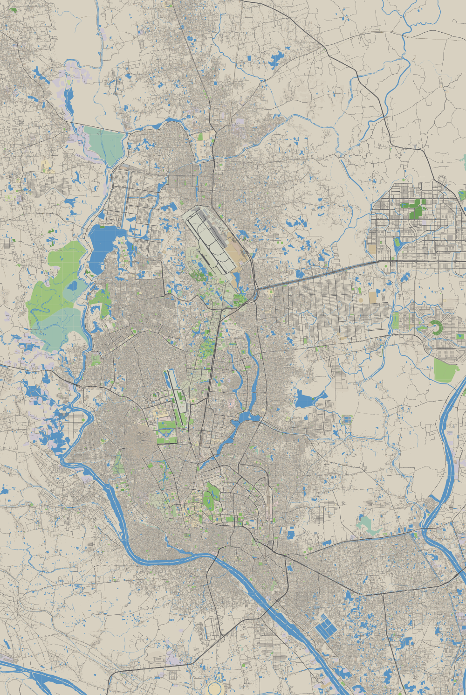

# Dhaka Bus Simulator

A browser-based 2D top-down bus driving game set on the **real map of Dhaka**, generated from
OpenStreetMap data at build time. TypeScript + Vite + PixiJS v8 (WebGL), deployable as a static site.

> Status: **Phase 5** — career mode: pick one of 5 real Dhaka bus routes (stops snapped to real OSM bus
> stops), pick up and drop off passengers, collect fares by distance, keep them happy, finish on time —
> through living traffic (rickshaws, CNGs, buses, signals, traffic police, pedestrians) on the real
> city map. Garage, weather and day/night arrive in Phase 6.

## Quick start

```bash
npm install
npm run data:build      # optional: processed data is committed; this regenerates it from OSM
npm run dev             # http://localhost:5173
```

`data:build` downloads the Bangladesh OSM extract (~360 MB, cached in `data/raw/`) and takes ~1.5 min
for all of Dhaka (needs ~3 GB RAM).

**After `npm run data:build`, restart `npm run dev`**: Vite caches public file sizes at startup
and would otherwise serve truncated chunks.

### Controls

| Action | Keyboard | Gamepad | Touch |
|---|---|---|---|
| Accelerate / brake (hold brake when stopped = reverse) | `W`/`S` or `↑`/`↓` | RT / LT | GAS / BRAKE pedals |
| Steer | `A`/`D` or `←`/`→` | left stick | steering wheel |
| Handbrake | `Space` | A | — |
| Horn (tap to spam, hold to blare; `Shift+H` changes horn) | `H` | B | 📯 |
| Doors (left side) | `E` | X | 🚪 |
| Headlights | `L` | RB | — |
| Reset to road (৳100 fine) | `R` | Y | ↺ |
| Camera: north-up / rotate with bus | `C` | LB | 🧭 |
| Fullscreen map + place search (click to teleport) | `M` | Back | Map |
| Bangla / English | `B` | — | বাং / EN |
| Zoom | wheel, `+`/`-` | — | pinch |
| Labels on/off, debug overlay | `N`, `F3` | — | — |

Dragging the map detaches the camera; it follows the bus again as soon as you drive. Start anywhere
with a URL hash: `http://localhost:5173/#23.7577,90.3897` (lat, lon[, zoom px/m]); the bus snaps to
the nearest road, in the left lane (Bangladesh drives on the left). Graphics quality:
`?quality=low|med|high` (default `med`, remembered).

### Data scripts

| Command | What it does |
|---|---|
| `npm run data:fetch` | Download/resume `data/raw/bangladesh-latest.osm.pbf` from Geofabrik |
| `npm run data:build` | fetch → extract → chunk → road graph → bus routes. `DHAKA_BBOX=core\|mid\|full` or `"minLat,minLon,maxLat,maxLon"`; `--force` re-extracts |
| `npm run data:validate` | Feature counts, PNG renders (`docs/img/`, full-res in `data/work/`), landmark + flyover position checks |
| `npm test` | Unit tests (geometry, format) + landmark and flyover checks against built data |



## Data pipeline

```
Geofabrik PBF ──► tools/extract.ts ──► data/work/<bbox>/features.ndjson ──► tools/chunk.ts ──► public/data/
 (cached, raw)     own PBF decoder       projected metres, classified          clip, simplify,     index.json
                   1–3 passes            + routes.json, restrictions.json      triangulate, gzip   lod0/X_Y.dbc
```

* **Decoder**: `tools/lib/pbf.ts` is a small dependency-free OSM PBF reader (zlib blobs, dense
  nodes, ways, relations). No osmium/GDAL needed; ~50M nodes decode in a few seconds.
* **Extract**: pass 1 keeps nodes inside the bbox + 1.3 km margin, ways touching them, and the
  relations we use (multipolygons, `route=bus`, turn restrictions). Pass 2/3 fetch multipolygon
  member ways and area nodes outside the margin so rivers and large campuses stay closed.
* **Projection**: local equirectangular centred on 23.80°N 90.41°E; **1 unit = 1 metre**, +y = south.
* **Levels of detail**: LOD0 512 m tiles (everything), LOD1 2 km tiles (buildings ≥ 300 m²,
  residential roads and up, 2–3 m simplification), LOD2 8 km tiles (secondary roads and up, rivers,
  large landuse; also feeds the minimap). The game picks the LOD from zoom with hysteresis and keeps
  the coarser tiles on screen until the finer ones covering the view have loaded.
* **Chunks**: 512 m tiles at LOD0. Polygons are clipped per tile (Sutherland–Hodgman) and pre-triangulated
  (earcut); buildings go to the tile of their centroid; lines are clipped with a 24 m overlap and carry
  their running distance so dashed markings stay continuous across tiles. Douglas–Peucker
  simplification (0.25–0.8 m). Coordinates are Int16 decimetres relative to the tile origin.
* **Format** (`src/shared/format.ts`): `"DBC1" | u32 jsonLen | JSON header | 8-byte aligned typed
  arrays`, gzip-compressed, served as `.dbc` (neutral extension, so no server adds
  `Content-Encoding`); the client inflates with `DecompressionStream`.

## Rendering

* Chunks stream in around the camera via a Web Worker pool, which fetches, inflates and tessellates
  them (round-joined road strokes, lane markings, zebra crossings, rails/sleepers, MRT viaduct).
* Each chunk contributes three meshes drawn with a custom per-vertex-colour shader:
  **ground** (landuse → water → footpaths → road casing → road fill → markings → railway),
  **shadow** and **upper** (buildings → flyovers → MRT viaduct and stations). Merging the sub-layers
  per chunk is safe because tiles overlap by the line margin and each tile contains every line piece
  inside it, so a tile drawn over its neighbour reproduces its own ordering. Vehicles go between
  shadow and upper; vehicles on flyovers go above upper.
* Shadows are extruded in the vertex shader from a per-vertex height (`uSun` uniform), so day/night
  sun angles cost nothing. All shadows are composited in one `AlphaFilter` pass so overlaps
  don't double-darken.
* Labels are screen-space `Text` (Noto Sans + Noto Sans Bengali), placed greedily by priority with
  collision boxes: road names along their longest straight run (kept upright), flyovers highlighted,
  places by rank and zoom, metro stations and landmarks.

## Driving model

* **Physics** (`src/game/BusPhysics.ts`, pure TS): kinematic bicycle model posed at the rear axle so the
  front overhang swings out in turns; speed-sensitive, rate-limited steering; 5-speed automatic with a
  torque curve, rpm, governor, rolling resistance and drag; brakes that never reverse the bus;
  handbrake slides the rear. Fixed 120 Hz step.
  * Local bus (11 m, 11.5 t): 0–40 km/h in 9.5 s, 40–0 braking in 9.3 m, governed at 80 km/h,
    rear-axle turning radius ~8 m.
  * BRTC double-decker (10.5 m, 15.5 t): 0–40 km/h 10.5 s, 40–0 in 10.1 m, 70 km/h.
* **Collisions** (`src/game/CollisionWorld.ts`): the worker returns building footprint triangles
  (already earcut-triangulated), MRT pillar positions and road centrelines for every LOD0 tile; a
  32 m grid per tile feeds SAT tests (bus box vs triangles, vs pillar circles). Contacts push the
  bus out, remove velocity into the obstacle, and impacts > 1.2 m/s add damage, a fine and a dent on
  the sprite. LOD0 tiles around the bus stay loaded at any zoom so physics never loses its data.
* **MRT pillars**: one every 30 m along the viaduct (OSM maps each track as its own way, so the pair
  is merged into one pillar in the median). Elevated stations don't block the road under them.
* **Flyovers**: the bus has an elevation level. It changes level only where roads of both levels
  overlap (ramp junctions), so driving under a flyover never teleports you onto it; on a deck the
  parapets keep you on the carriageway and buildings below are ignored. A light outline shows the
  bus when it is under a deck, the viaduct or a station.
* **Sound**: synthesised with WebAudio for now (diesel engine following rpm/throttle, four horn
  styles including the melodic "pressure horn", brake squeal, door hiss, crash). Recorded samples
  replace these in Phase 7.

## Routes, passengers and fares (Phase 5)

* **5 routes** (`docs/ROUTES.md`, generated): Mirpur 10 – Farmgate (6.2 km, free), Mirpur 10 – Motijheel
  (13.1 km), Gabtoli – Sayedabad (13.9 km), Airport – Motijheel (18.1 km), Uttara – Sadarghat
  (23.2 km); both directions each. OSM has almost no Dhaka bus route relations, so routes are
  defined as ordered stops (`tools/routes.config.ts`), each snapped to the matching OSM bus stop
  (45 of 56 stops matched), and joined by the game's router; a Viterbi pass over candidate nodes
  picks the right carriageway so the bus doesn't U-turn at stops.
* **Driving a route** (`src/game/career/RouteRun.ts`): a guide line in the route colour, bus-stop
  shelters with waiting passengers, and a pulsing yellow **stop box** where the front door should be.
  Stop inside it, open the doors (`E`): passengers alight first, then board (~0.5 s each through two
  doors). The conductor shouts the stop and onward destinations (browser speech synthesis, Bangla
  voice when available); the PA announces the next stop 150 m before it.
* **Seating**: 26 seats + 9 ladies' seats (women and the elderly sit there first), 20 standing, and
  at rush hour up to 8 passengers hang off the door. Standees take seats as people leave.
* **Fares**: BRTA city-bus rate ৳2.45/km, minimum ৳10, students half (minimum ৳5), by distance
  between boarding and alighting stops; collected by the conductor when passengers get off. Very
  unhappy passengers argue and pay 70%.
* **Satisfaction** (per passenger, HUD shows the average): harsh acceleration/braking and swerving,
  speeding, crashes, doors open while moving, standing/hanging, long waits at stops and stopping far
  from the stop lower it; smooth driving and precise stops raise it.
* **Penalties**: driving past a stop that had people waiting or wanting to get off (missed stop),
  leaving passengers behind with room aboard (skipped), being late (time limit ≈ 20 km/h average + 20 s
  per stop). Collisions are only fined when the bus was moving.
* **Results & career**: stars (scaled by how much of the route you served), fares + on-time bonus −
  fines go to your career money, reputation changes; buy route permits to unlock longer routes.
  Career progress is saved in `localStorage`.
* **Screens**: start screen (Career / Free roam), route picker (direction choice, unlock prices, best
  stars), results, pause (`Esc`/`P`), stop list (`Tab`). `?free` skips the menu; `?debug` shows the
  F3 overlay at start.

## Traffic (Phase 4)

* **Road graph** (`tools/graph.ts` → `public/data/graph.dgz`, 1.4 MB): drivable OSM roads split at
  junctions, way ends and signal nodes — 68.5k nodes, 88.9k edges, 99% in one connected component —
  with one-way flags, flyover levels, lanes, widths, speed limits (OSM `maxspeed` or class defaults),
  names and node-via turn restrictions (24 usable; via-way restrictions are skipped). Node positions,
  edge lengths, geometry offsets and adjacency are derived on load; interior points are Int16 deltas.
* **Router** (`src/game/Router.ts`): edge-based A* by travel time, so turn restrictions are exact;
  respects one-way streets; profiles for bus, car and rickshaw (rickshaws are banned from primary/trunk
  roads and flyovers, as on Dhaka's main roads). Tested: Farmgate → Shapla Chattar, Mirpur 10 →
  Gulistan, Uttara → Sadarghat.
* **Vehicles** (`src/game/traffic/`): spawned around the player on the real graph, weighted towards
  main roads, appearing just outside the visible area. Intelligent Driver Model car-following against
  anything in the lateral corridor ahead (other vehicles, the player's bus, crossing pedestrians).
  Left-hand traffic; each type has its own kerb preference and "weave" factor — rickshaws hug the
  kerb, CNGs and motorcycles squeeze past whatever is slow, buses stop for passengers in the middle of
  the road. Random-walk routing at junctions favours straight on and bigger roads. Drivers honk when
  held up (rate-limited, distance-attenuated).
  Mix (daytime weights): rickshaw 26, car 18, CNG 17, motorcycle 14, bus 9, pickup 4, leguna 3,
  taxi 2, police 0.8, ambulance 0.6; trucks 3% by day and 22% at night (city truck ban).
* **Density** follows the game clock (1 real second = 1 game minute, starting Sunday 8:30): morning
  and evening rush, quiet nights, near-empty Friday mornings; quality presets scale it; jam hotspots
  (Farmgate, Mohakhali, Gulistan, Jatrabari, Shahbag) add traffic that builds and clears over time.
* **Signals**: the 93 OSM signal nodes are clustered per junction into controllers with two phase
  groups split by approach axis (green / 3 s yellow / 2 s all-red). Junctions where ≥3 major roads
  with different names meet get a **traffic constable** instead (long manual phases, drawn on a stand
  with white gloves pointing at the moving road) — 258 controllers in all, 218 police. 6% of signals
  are broken (flashing amber; everyone slows and goes).
* **Pedestrians**: walk the footpaths beside real roads, jaywalk (much more often at mapped
  crossings), pause if a vehicle is right in front of them, dodge the bus (usually), and street
  vendors stand with fruit carts on main roads.
* **Rules & fines**: red light ৳500 (৳300 at a police junction), wrong way on a one-way street ৳300
  (with a flashing banner), collisions by impact speed and the other vehicle's mass, ৳5,000 for
  hitting a pedestrian.
* **Cost**: ~2.5 ms CPU per frame for ~370 vehicles + ~100 pedestrians (browser); vehicles are
  batched sprites from textures baked once at startup.
* Beyond the ~330 m simulation radius there is no traffic simulation (no statistical-flow model
  yet); vehicles appear and disappear just out of sight.

## Performance

Measured with an in-page benchmark (`__game.bench()`, GPU-synchronised) at 1280×800 on a
deliberately weak GPU (AMD Radeon HD 6450, 2011), Shahbag at zoom 0.5 px/m (48 chunks, 0.87M vertices):

| Preset | MSAA | Shadows | Max resolution | Frame time |
|---|---|---|---|---|
| low | off | off | 1× | 10–13 ms |
| med (default) | off | on | 1.5× | 13–17 ms |
| high | 4× | on | 2× | 18–28 ms |

World update and label placement together take < 1 ms; rendering is fill-rate bound on this GPU, so a
mid-range laptop GPU should hold 60 fps on `high`.

**Size**: processed data is 40 MB in total (LOD0 30 MB, LOD1 3.5 MB, LOD2 0.27 MB, search index 0.5 MB),
loaded lazily. First load is ~1.5 MB: app JS ~170 KB gz, `index.json` 44 KB, LOD2 for the minimap
0.27 MB, and the ~35 LOD0 tiles in view (median tile 6 KB, dense centre up to ~33 KB).

## Decisions & assumptions

* **No osmium/ogr2ogr on the build machine**, and Overpass returned 406/limits, so the PBF is decoded
  in TypeScript.
* **Water draws above parks** (the spec lists landuse, water, parks). Dhaka's lakes (Dhanmondi,
  Ramna, Gulshan) sit inside park polygons and would otherwise be hidden.
* **Untagged building heights**: OSM rarely has `height`/`building:levels` in Dhaka, so untagged
  buildings get a deterministic pseudo-random height of 9–24 m (typical 3–7 storeys) derived from the
  OSM id. Tagged values are always used when present.
* **Dual carriageways**: one-way secondary-and-above roads without `lanes` get ~62% of the class width,
  since they are usually one half of a divided road.
* **MRT**: `railway=subway|light_rail` that isn't tagged as a tunnel is treated as elevated (layer 2).
  Stations are drawn as a 190 × 24 m roofed box over the viaduct at each station node within 60 m of it.
* **Processed data is committed** (40 MB) so the repo deploys without the 360 MB download.
  Regenerate with `npm run data:build`.
* **OSM bus route relations are sparse** in Dhaka (only a handful are tagged); Phase 5 will build
  routes from road ways + named stops (see `docs/ROUTES.md`).
* **Elevated buildings**: `layer=1` on buildings is common in Dhaka OSM and is ignored; a building is
  treated as elevated (rendered, not an obstacle) with `min_level`/`building:min_level` ≥ 1,
  `min_height` ≥ 2.5 m, `layer` ≥ 3, or `layer` ≥ 2 on a station/transport building (51 in the city,
  mostly MRT stations).
* **Medians** of dual carriageways are not modelled as obstacles yet: OSM maps them as the gap
  between two one-way ways, and the gap is drivable. MRT pillars are.
* Validation reference coordinates for Shapla Chattar and Mohakhali Bus Terminal were corrected to
  their published positions, which OSM matches within 76 m and 23 m respectively.

## License

Code: MIT. Map data: © OpenStreetMap contributors, ODbL 1.0 (see `docs/ASSETS.md`).
